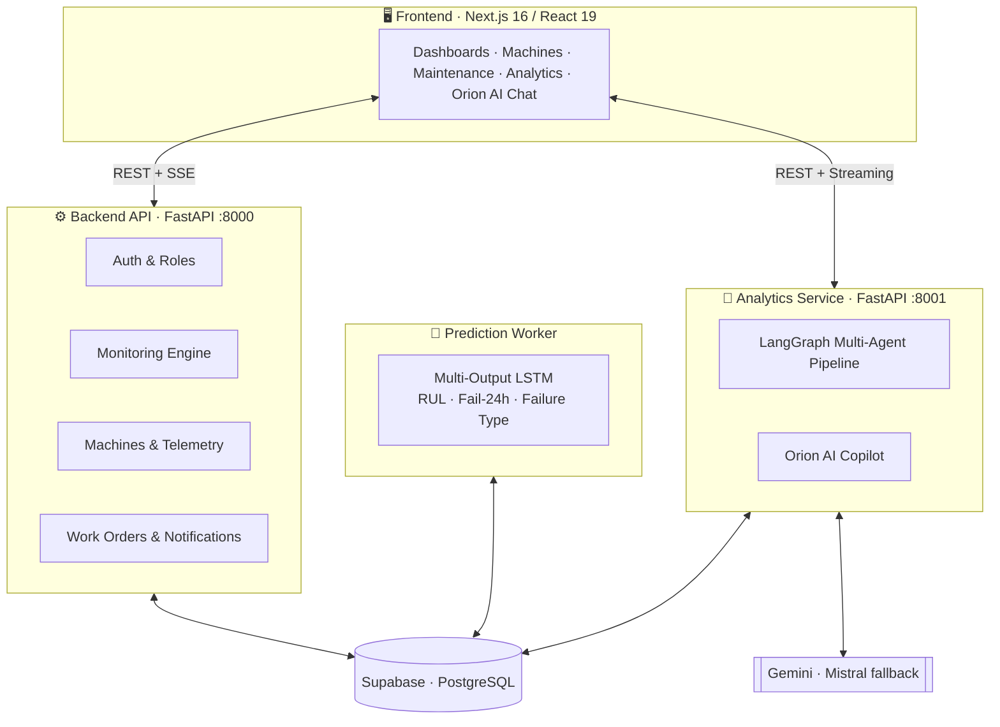
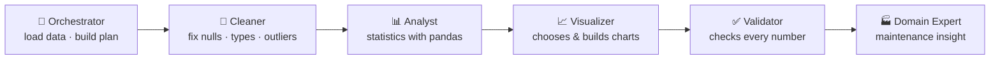

<!-- IntelliViz · README by Usama Shahid (fewgets) -->
<div align="center">


<p>
  
  
  
  
  
  
  
</p>

<p>
  <a href="#-overview"><b>Overview</b></a> · <a href="#%EF%B8%8F-system-architecture"><b>Architecture</b></a> · <a href="#-machine-learning-predictive-maintenance-model"><b>ML Model</b></a> · <a href="#-orion-ai-multi-agent-analytics--copilot"><b>Orion AI</b></a> · <a href="#-team"><b>Team</b></a>
</p>

</div>

---
## 📌 Table of Contents

- [Overview](#-overview)
- [The Problem](#-the-problem)
- [Key Features](#-key-features)
- [System Architecture](#-system-architecture)
- [Machine Learning: Predictive Maintenance Model](#-machine-learning-predictive-maintenance-model)
- [Orion AI: Multi-Agent Analytics & Copilot](#-orion-ai-multi-agent-analytics--copilot)
- [Dashboard Modules](#-dashboard-modules)
- [Tech Stack](#-tech-stack)
- [Security & Reliability](#-security--reliability)
- [Testing](#-testing)
- [Project Status & Roadmap](#-project-status--roadmap)
- [Team](#-team)
- [Source Code](#-source-code)
- [Let's Work Together](#-lets-work-together)

---

## 🔭 Overview

**IntelliViz** is an end-to-end industrial intelligence platform that turns raw machine sensor data into
decisions. It monitors a fleet of industrial machines in real time, uses a deep-learning model to predict
**when** a machine will fail and **why**, schedules maintenance through work orders, and lets plant staff
ask questions about their data in plain language through **Orion AI**, a multi-agent analytics copilot.

The platform is built around one principle: **AI reasons and explains, code calculates and verifies.**
Every number shown to the user comes from real computation, not from a language model's guess.

| | |
|---|---|
| 🏭 **Domain** | Industrial predictive maintenance (CNC machines, pumps, compressors, robotic arms) |
| 👥 **Users** | Plant managers, maintenance engineers, machine operators, production analysts |
| 🎯 **Goal** | Reduce unplanned downtime, plan maintenance before failure, make plant data easy to understand |

---

## ❗ The Problem

Unplanned machine downtime is one of the largest hidden costs in manufacturing. Most plants either:

- **Repair after failure:** expensive emergency repairs, lost production, safety risks; or
- **Service on a fixed schedule:** healthy parts are replaced too early, while failing parts can still be missed.

Sensor data that could warn of a failure usually sits unused in databases, and the people who need answers
(managers, operators) are not data scientists.

**IntelliViz closes this gap:** it reads the sensors continuously, predicts failures in advance, and explains
the situation in a way anyone on the shop floor can act on.

---

## ✨ Key Features

### 📡 Real-Time Fleet Monitoring
- Live telemetry for every machine: vibration, motor temperature, current, pressure, RPM
- Server-Sent Event streams so dashboards update without manual refresh
- Per-machine operating state, data-freshness detection ("stale data" warnings), health bands
- Configurable sensor limits and operation profiles per machine category

### 🧠 Predictive Maintenance (Deep Learning)
- Multi-output **LSTM** model predicts, for every machine:
  - **Remaining Useful Life (RUL)** in hours
  - **Probability of failure within the next 24 hours**
  - **Likely failure type**: bearing, hydraulic, electrical or motor overheat
- A background prediction worker scores new readings continuously and writes the results to the database

### 🛠️ Maintenance Management
- Work orders with full status history and audit trail
- Maintenance team management
- Maintenance logs per machine, plus AI-generated maintenance recommendations

### 🤖 Orion AI Copilot
- Chat with your plant data in plain English
- A multi-agent pipeline cleans, analyses and visualises data, then validates every number before answering
- Automatically generated analytics dashboards with charts and KPIs
- Upload your own CSV or Excel files for analysis
- Admin-controlled AI policy, guardrails and prompt-injection protection

### 🔔 Alerts & Notifications
- Anomaly detection with drill-down to the exact moment an anomaly occurred
- Alert centre with read/unread tracking

### 🎨 Modern Experience
- Dark and light themes, responsive layout, animated interface
- Role-based access: **Admin** and **Operator**

---

## 🏗️ System Architecture

IntelliViz is built as four cooperating services on top of a shared Supabase (PostgreSQL) database.



| # | Service | Port | Responsibility |
|---|---|---|---|
| 1 | **Frontend** (Next.js) | `3000` | User interface, charts, real-time views, chat |
| 2 | **Backend API** (FastAPI) | `8000` | Authentication, machines, telemetry, dashboard snapshot, monitoring, work orders |
| 3 | **Prediction Worker** (PyTorch) | none | Runs the LSTM model on new readings and stores predictions |
| 4 | **Analytics Service** (FastAPI + LangGraph) | `8001` | Multi-agent analytics, Orion AI copilot, dataset uploads, auto-dashboards |

All four services are containerised and can be started together with **Docker Compose**.

### Backend layering

```
Routes (HTTP)  →  Services (business logic)  →  Repository (database access)  →  Supabase
```

Routes stay thin, business rules live in services, and every database query goes through one repository
layer, so each part can be tested on its own.

---

## 🧠 Machine Learning: Predictive Maintenance Model

### Dataset

| Property | Value |
|---|---|
| Records | **24,042** time-stamped sensor readings |
| Machines | **20** machines of 4 types: CNC, Pump, Compressor, Robotic Arm |
| Sensor features | `vibration_rms`, `temperature_motor`, `current_phase_avg`, `pressure_level`, `rpm` |
| Context features | `operating_mode`, `hours_since_maintenance`, `ambient_temp` |
| Targets | `rul_hours`, `failure_within_24h`, `failure_type` |
| Failure classes | none · bearing · motor overheat · hydraulic · electrical |

### Model

A **multi-task LSTM** learns all three targets at once from a sliding window of recent readings:

```
Last 10 readings ──► LSTM (2 layers, 128 hidden, dropout 0.3) ──┬──► RUL (regression, hours)
                                                                ├──► Failure in 24 h (binary)
                                                                └──► Failure type (5-class)
```

| Hyper-parameter | Value |
|---|---|
| Sequence length | 10 time steps |
| Layers / hidden size | 2 / 128 |
| Dropout | 0.3 |
| Optimiser / learning rate | Adam / 0.001 |
| Batch size / epochs | 64 / 30 |

### Results

Results on the evaluation sample used in the deployed model:

| Task | Metric | Score |
|---|---|---|
| **Failure within 24 h** | Accuracy | **99.17%** |
| | Precision | **100%** |
| | Recall | **94.44%** |
| | F1-score | **97.14%** |
| **Failure type** | Accuracy | **98.33%** |
| | Weighted F1 | **98.16%** |
| **Remaining Useful Life** | MAE | **13.7 h** |
| | RMSE | **20.4 h** |

### Rigorous evaluation

To test the model honestly, it was retrained under stricter, leakage-free set-ups:

| Experiment | What it tests | RUL MAE | Fail-24h F1 | Fault-type acc. |
|---|---|---:|---:|---:|
| **Temporal (clean)** | Predicting *future* readings of known machines | **6.58 h** | 90.48% | 97.71% |
| **Temporal multi-task** | Future readings, all three tasks together | 20.32 h | 93.33% | 97.86% |
| **Machine hold-out** | Machines the model has *never seen* | 18.48 h | 70.92% | 90.09% |
| **Gradient boosting baseline** | Classical ML comparison | 22.67 h | 97.76% | 99.12% |

> On the cleanest temporal split, the LSTM predicts remaining useful life **more than 3× more accurately**
> than the gradient-boosting baseline (6.58 h vs 22.67 h MAE). The machine hold-out results show the
> realistic difficulty of predicting failures on completely new equipment, which is the main focus of future work.

---

## 🤖 Orion AI: Multi-Agent Analytics & Copilot

Orion AI lets users ask questions such as *"Which machines are most at risk this week?"* or
*"Why did vibration spike on the CNC line?"* and get answers backed by real calculations.

### Agent pipeline (LangGraph)



| Agent | Role | Uses an LLM? |
|---|---|---|
| **Orchestrator** | Validates input, loads the data source, decides which agents run | ❌ Rule-based |
| **Cleaner** | Detects and repairs data-quality problems | Tools + LLM reasoning |
| **Analyst** | Runs real statistical analysis through code tools | Tools + LLM reasoning |
| **Visualizer** | Picks suitable charts: time series, distribution, comparison, composition, relationship | Tools + LLM reasoning |
| **Validator** | Checks every reported number against the computed results, using a scoring rubric | ❌ Code checks |
| **Domain Expert** | Turns results into maintenance-focused insights | ✅ |

**Design rules**
- If any agent reports an error, the run stops there, so bad state never travels downstream.
- An agent never runs before the agents it depends on.
- LLMs never do arithmetic; numbers come only from code tools and are checked by the validator.

### Copilot capabilities
- 💬 Chat sessions with history, renaming, deletion and answer feedback
- ⚡ Streaming responses
- 🛡️ Guardrails: scope control, prompt-injection defence, answer verification
- 📋 Admin-editable AI policy with version history
- 🔁 Automatic fallback from **Gemini** to **Mistral** when the primary provider is busy
- 📊 Tracing of every agent step through **LangSmith**

---

## 🖥️ Dashboard Modules

| Module | Description |
|---|---|
| **Welcome** | Personalised AI briefing of the plant's current state |
| **Overview** | Fleet-level KPIs, system health and recent alerts |
| **Dashboard** | Live telemetry and operational snapshot |
| **Machines** | Per-machine detail: sensors, predictions, maintenance history; add new machines |
| **Anomalies** | Detected anomalies with drill-down to the exact timestamp |
| **Maintenance** | Work orders, team, schedules and predictive trend charts |
| **System Health** | Health bands and data freshness across the fleet |
| **Energy** | Power and electrical measurements |
| **Production** | Production output views |
| **Analytics** | AI-generated analytics runs and auto-built dashboards |
| **Orion AI / Assistant** | Conversational copilot over plant data and uploaded files |
| **Alerts** | Alert centre with detail pages |
| **Admin** | User roles, monitoring settings, AI copilot policy |

---

## 🧰 Tech Stack

<table>
<tr><th>Layer</th><th>Technologies</th></tr>
<tr><td><b>Frontend</b></td><td>Next.js 16 (App Router), React 19, TypeScript, Tailwind CSS, shadcn/ui (Radix UI), TanStack React Query, Recharts, Chart.js, Plotly, Framer Motion</td></tr>
<tr><td><b>Backend API</b></td><td>Python, FastAPI, Uvicorn, Pydantic, Server-Sent Events</td></tr>
<tr><td><b>Machine Learning</b></td><td>PyTorch (LSTM), scikit-learn, pandas, NumPy</td></tr>
<tr><td><b>AI / Agents</b></td><td>LangGraph, LangChain, Google Gemini, Mistral AI (fallback), LangSmith tracing</td></tr>
<tr><td><b>Data Analysis</b></td><td>pandas, SciPy, openpyxl (Excel uploads)</td></tr>
<tr><td><b>Database</b></td><td>Supabase (PostgreSQL) with versioned SQL migrations</td></tr>
<tr><td><b>Testing</b></td><td>pytest, Vitest</td></tr>
<tr><td><b>DevOps</b></td><td>Docker, Docker Compose</td></tr>
</table>

---

## 🔐 Security & Reliability

- **Authentication & roles:** signed tokens with *Admin* and *Operator* roles; admin-only actions are enforced on the server
- **Secrets** live only in environment files, never in source control or the browser
- **Input validation:** every request and response is typed with Pydantic, and filters are allow-listed and range-checked
- **Upload security:** uploaded datasets are size-limited and checked before they are processed
- **AI safety:** prompt-injection tests, a red-team script, scope guardrails, and verification of every AI answer
- **Database write guards:** SQL migrations add server-side protections on writes
- **Resilient monitoring:** a background monitoring task runs independently of the browser; concurrent instances use optimistic concurrency and atomic database procedures
- **Cost tracking:** LLM token usage and cost are recorded per run

---

## 🧪 Testing

| Service | Framework | Coverage |
|---|---|---|
| Backend API | pytest | Auth, dashboard API, fleet snapshot, live state, monitoring, monitoring settings, work orders |
| Analytics service | pytest | Every agent, workflow and plan, chart and cleaning tools, statistics, copilot scope and guardrails, prompt injection, upload security, API |
| Frontend | Vitest | Auth, copilot history and policy, fleet telemetry, page context, welcome briefing |

**35+ Python test modules** plus frontend unit tests, including fake database and LLM layers so the full
pipeline can be tested without network access.

---

## 🗺️ Project Status & Roadmap

### ✅ Completed
- Real-time fleet monitoring with live streams
- LSTM predictive-maintenance model and background prediction worker
- Maintenance work orders, team and history
- Orion AI multi-agent analytics and copilot
- Authentication with Admin/Operator roles
- Docker Compose deployment for all four services
- Automated test suites for every service

### 🔜 Future Work
- Better generalisation to machines the model has never seen
- Cyber-attack and sensor-tampering detection on IoT streams
- Mobile notifications for critical alerts
- Cloud deployment with CI/CD

---

## 👥 Team

<div align="center">

| Member | Roll No. |
|---|---|
| **Afnan Shoukat** | BSAI-207 |
| **Usama Shahid** | BSAI-180 |
| **Dur-e-Adan Noor** | BSAI-211 |

**Supervisor:** Hina Ali

Department of Computer Science
**National University of Modern Languages (NUML), Islamabad**

</div>

---

## 📂 Source Code

This repository is a **project showcase**. The full source code (frontend, backend API, prediction worker,
analytics service, trained models and datasets) is kept private as part of our Final Year Project.

**Want a demo, collaboration or access to the code?** Get in touch below.

---

## 🤝 Let's Work Together

<div align="center">

**Have an idea, a freelance project, or want to collaborate on something in AI?**
I'm always open to collaborations, freelance work and full-time opportunities.

<a href="mailto:shaikhusama541@gmail.com?subject=Collaboration%20-%20IntelliViz">
  
</a>
<a href="https://www.linkedin.com/in/-usamashahid/">
  
</a>
<a href="https://github.com/fewgets">
  
</a>

<br/><br/>

⭐ **If you like this project, please give it a star. It really helps!** ⭐

<br/>

<h3>"AI reasons and explains. Code calculates and verifies."</h3>


</div>
